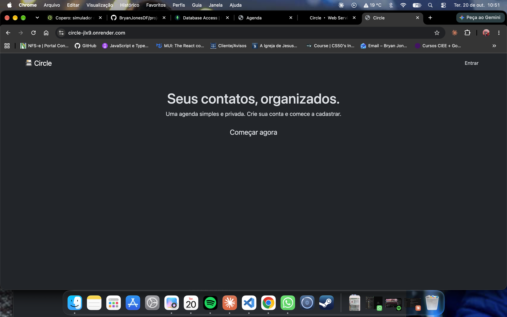
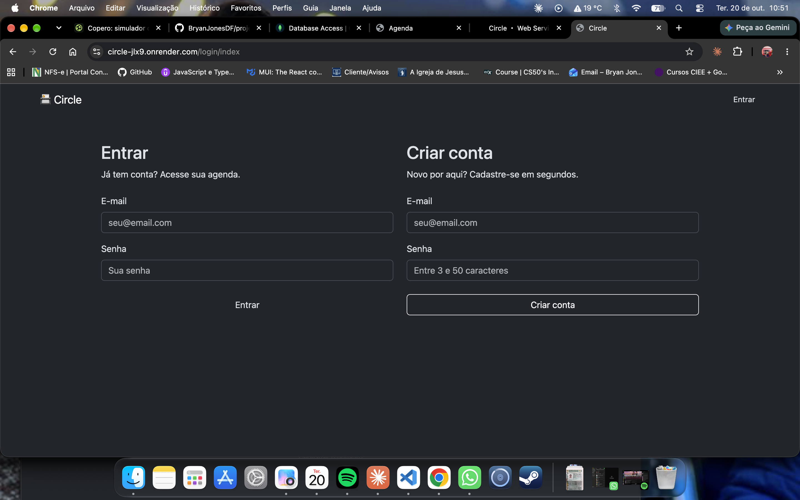
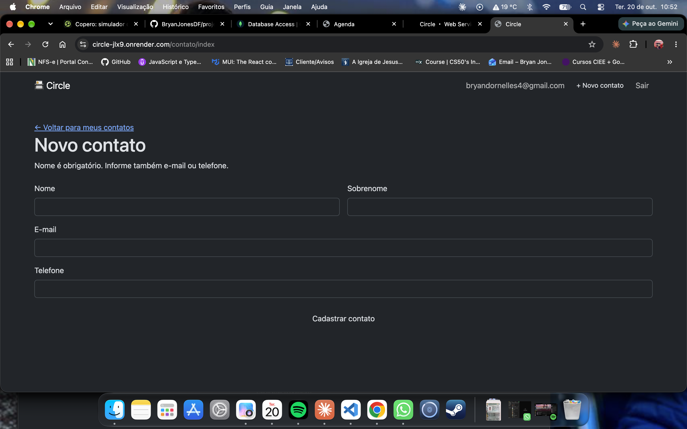

# Circle

**Acesse:** https://SEU-LINK.onrender.com

**Conta de demonstração:** `demo@circle.com` / `demo123`

>Hospedado no plano gratuito do Render: o primeiro acesso pode levar até 1 minuto para carregar.

Aplicação web full-stack para cadastro e gerenciamento de contatos, com autenticação de usuários. Cada usuário tem sua própria agenda privada.

Desenvolvida com **Node.js, Express e MongoDB**, seguindo o padrão **MVC**.


## Funcionalidades

- **Cadastro e login de usuários** com senha criptografada
- **Sessões persistentes** armazenadas no banco de dados
- **CRUD completo de contatos**: criar, listar, editar e excluir
- **Agenda privada por usuário**: cada usuário vê e altera apenas os próprios contatos
- **Rotas protegidas**: páginas de contatos acessíveis apenas para usuários logados
- **Validação dupla**: no front-end (resposta instantânea) e no back-end (segurança)
- **Mensagens de feedback** de sucesso e erro após cada ação

## Telas

### Lista de contatos


### Login e cadastro


### Validação do formulário



## Tecnologias

**Back-end:** Node.js · Express · MongoDB Atlas · Mongoose
**Views:** EJS · Bootstrap 5
**Front-end:** JavaScript (ES6+) · Webpack · Babel
**Autenticação e sessão:** express-session · connect-mongo · bcryptjs · connect-flash
**Segurança:** Helmet · CSRF (csurf) · dotenv · validator


## Segurança

- **Senhas com hash (bcrypt)**: nenhuma senha é salva em texto puro
- **Proteção CSRF**: todo formulário POST exige um token válido
- **Proteção contra IDOR**: buscas, edições e exclusões filtram pelo dono do contato (`criadoPor`), impedindo o acesso a contatos de outros usuários pela URL
- **Identidade vinda da sessão**: o dono de cada contato é definido pelo servidor, nunca por dados enviados no formulário
- **Cabeçalhos HTTP seguros** com Helmet e Content Security Policy
- **Variáveis sensíveis** (conexão com o banco e segredo da sessão) mantidas fora do repositório com `.env`
- **Mensagem de login genérica** ("Usuário ou senha inválidos"), que não revela se um e-mail está cadastrado

## Estrutura do projeto

```
├── frontend/           # JavaScript do navegador (validação dos formulários)
│   └── modules/        # Uma classe de validação por formulário
├── public/             # Arquivos estáticos (bundle gerado pelo Webpack)
├── src/
│   ├── controllers/    # Recebem a requisição e decidem a resposta
│   ├── models/         # Regras de negócio, validação e acesso ao banco
│   ├── middlewares/    # Login obrigatório, CSRF, variáveis globais
│   └── views/          # Templates EJS
├── routes.js           # Definição das rotas
└── server.js           # Configuração do Express e conexão com o banco
```

## Como rodar localmente

**Pré-requisitos:** Node.js e uma conta gratuita no MongoDB Atlas.

1. Clone o repositório:
```bash
   git clone https://github.com/BryanJonesDF/projetoAgenda.git
   cd projetoAgenda
```

2. Instale as dependências:
```bash
   npm install
```

3. Crie um arquivo `.env` na raiz, com base no `.env.example`:
```
   CONNECTIONSTRING=sua_string_de_conexao_do_mongodb
   SESSION_SECRET=um_texto_secreto_qualquer
```

4. Em um terminal, gere o bundle do front-end:
```bash
   npm run dev
```

5. Em outro terminal, inicie o servidor:
```bash
   npm start
```

6. Acesse **http://localhost:3000**


## Aprendizados

- Organização de uma aplicação no padrão **MVC** e separação de responsabilidades
- Encadeamento de **middlewares** no Express
- Autenticação com **sessões** e armazenamento seguro de senhas
- Identificação e correção de uma falha de **IDOR** (acesso a dados de outros usuários)
- Diferença entre **validação no front-end** (experiência do usuário) e **no back-end** (segurança)
- Diferença entre métodos do Mongoose que recebem **id** (`findById`) e os que recebem **filtro** (`findOne`, `findOneAndDelete`)


## Próximos passos

- [x] Design próprio
- [x] Deploy
- [ ] Busca de contatos por nome


## Autor

**Bryan Jones Dornelles Fagundes**
[GitHub](https://github.com/BryanJonesDF)